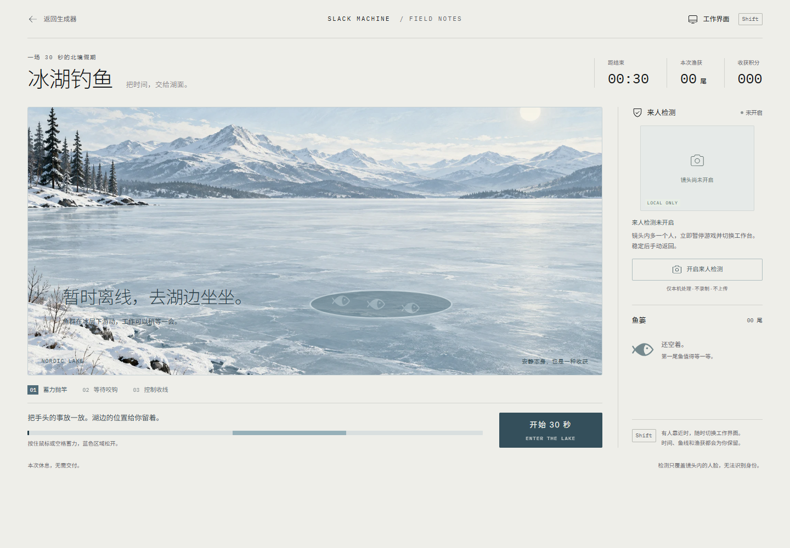

# 摸鱼生成器

北欧冷淡风的随机摸鱼方案生成器，内置 30 秒「冰湖钓鱼」和本地来人检测。

[在线试玩](https://links2008.github.io/slack-machine/)



## 作品简介

《摸鱼生成器》是一款北欧冷淡风的带薪休息小站：随机抽取摸鱼方案，在冰湖边蓄力抛竿、控制张力收线。开启本地来人检测后，镜头中出现额外人脸，游戏会暂停并切换为工作界面，让“摸鱼”变成一场安静又有反差感的互动体验。

TRAE Friend 活动命题：用北欧冷淡风，做一个关于摸鱼的随机生成器。

源码位于 main 分支，GitHub Pages 从 gh-pages 分支发布。

## 运行

使用 Node.js 22.18 或更高版本。开发环境执行 `npm install`，再执行 `npm run dev -- --port 5178`。

- `npm test`：验证钓鱼计分、暂停、结算、单人校准和额外人脸触发规则。
- `npm run build`：TypeScript 检查和生产构建。
- `npm run preview`：预览生产构建。

## 小游戏与工作界面

1. 在结果面板下方点击「冰湖钓鱼」。
2. 点击「开始 30 秒」，按住鼠标或空格蓄力，在蓝色区域松开抛竿；咬钩后提竿，通过按住和松开控制张力，成功收线获得渔获与积分。
3. 点击「开启来人检测」，授权摄像头并独自面对镜头，等待校准完成。
4. 连续检测到额外人脸后，整页切换为项目工作台，浏览器标签标题同步改变，游戏暂停并保留进度。
5. 画面重新稳定为单人后，点击工作台右下角「返回」继续。不会自动露出游戏。

Shift 和「工作界面」按钮随时可手动切换。松开 Shift 不恢复。摄像头未启用时也可以试玩。

## 检测边界

- 检测的是镜头内的人脸数量，不识别身份，也不判断谁是老板。镜头之外、背对镜头、遮挡及逆光可能导致漏检。
- 摄像头只在点击开启后申请授权，仅请求视频，不使用麦克风，不上传、不录制、不保存画面。
- 模型在浏览器的独立工作线程中运行，约每 200 毫秒处理一帧；多人需要连续两帧确认，稳定单人五帧后才允许手动恢复。
- 已完成校准后持续丢失人脸、摄像头断开或检测器失效，也会暂停并切换。可以关闭检测后使用 Shift 手动切换。
- 关闭检测会停止全部视频轨道并终止检测工作线程。授权被拒绝、没有摄像头时会显示说明。
- 摄像头需要 localhost 或 HTTPS，浏览器会保留正常的摄像头使用提示。
- 模型和 WebAssembly 运行资源位于 `public/vision/`，随构建复制；检测过程不依赖外部 CDN。原页面的在线字体仍由浏览器按原设置加载。

当前检测基于 MediaPipe Tasks Vision 1.1.1 与 BlazeFace 短距离模型。真实镜头的视野、距离与光线应在活动现场试用；自动化验证使用模拟视频流和真实检测模型。

## 官方文档

- [MediaPipe 网页人脸检测](https://developers.google.com/edge/mediapipe/solutions/vision/face_detector/web_js)
- [浏览器摄像头授权](https://developer.mozilla.org/en-US/docs/Web/API/MediaDevices/getUserMedia)

## 原始模板说明

This template provides a minimal setup to get React working in Vite with HMR and some Oxlint rules.

Currently, two official plugins are available:

- [@vitejs/plugin-react](https://github.com/vitejs/vite-plugin-react/blob/main/packages/plugin-react) uses [Oxc](https://oxc.rs)
- [@vitejs/plugin-react-swc](https://github.com/vitejs/vite-plugin-react/blob/main/packages/plugin-react-swc) uses [SWC](https://swc.rs/)

## React Compiler

The React Compiler is not enabled on this template because of its impact on dev & build performances. To add it, see [this documentation](https://react.dev/learn/react-compiler/installation).

## Expanding the Oxlint configuration

If you are developing a production application, we recommend enabling type-aware lint rules by installing `oxlint-tsgolint` and editing `.oxlintrc.json`:

```json
{
  "$schema": "./node_modules/oxlint/configuration_schema.json",
  "plugins": ["react", "typescript", "oxc"],
  "options": {
    "typeAware": true
  },
  "rules": {
    "react/rules-of-hooks": "error",
    "react/only-export-components": ["warn", { "allowConstantExport": true }]
  }
}
```

See the [Oxlint rules documentation](https://oxc.rs/docs/guide/usage/linter/rules) for the full list of rules and categories.
